# Café soluble · material para ChatGPT

Carpeta pública con todo lo que hace falta para seguir el vídeo **"How instant coffee is made"**: las tomas ya generadas, los diseños de referencia de la animación, los vídeos, el guion y el montador.

Carpeta en GitHub: https://github.com/jsgonzalezE/juan/tree/claude/install-anatomy-skill/figures/instant-coffee/traspaso

## Enlaces directos (para pegar en ChatGPT)

| Qué es | Enlace directo |
|---|---|
| Prompt maestro y lista de tomas | https://raw.githubusercontent.com/jsgonzalezE/juan/refs/heads/claude/install-anatomy-skill/figures/instant-coffee/traspaso/TRASPASO-CHATGPT.md |
| Guion de tomas (duración, cámara, rótulos, locución) | https://raw.githubusercontent.com/jsgonzalezE/juan/refs/heads/claude/install-anatomy-skill/figures/instant-coffee/traspaso/storyboard.json |
| Montador del prototipo (Python + ffmpeg) | https://raw.githubusercontent.com/jsgonzalezE/juan/refs/heads/claude/install-anatomy-skill/figures/instant-coffee/traspaso/animatic.py |
| Guion con prompts por toma | https://raw.githubusercontent.com/jsgonzalezE/juan/refs/heads/claude/install-anatomy-skill/figures/instant-coffee/traspaso/storyboard-prototipo.md |
| Proceso técnico organizado | https://raw.githubusercontent.com/jsgonzalezE/juan/refs/heads/claude/install-anatomy-skill/figures/instant-coffee/traspaso/proceso-organizado.md |
| Prompts de imagen (estilos A y B) | https://raw.githubusercontent.com/jsgonzalezE/juan/refs/heads/claude/install-anatomy-skill/figures/instant-coffee/traspaso/prompts-imagenes.md |
| Toma 1 aprobada (portada) | https://raw.githubusercontent.com/jsgonzalezE/juan/refs/heads/claude/install-anatomy-skill/figures/instant-coffee/traspaso/fotos/shot-01.png |
| Toma 2 aprobada (tostadora) | https://raw.githubusercontent.com/jsgonzalezE/juan/refs/heads/claude/install-anatomy-skill/figures/instant-coffee/traspaso/fotos/shot-02.png |
| Vídeo de la animación guiada (82 s) | https://raw.githubusercontent.com/jsgonzalezE/juan/refs/heads/claude/install-anatomy-skill/figures/instant-coffee/traspaso/referencias/animacion-guiada.mp4 |
| Prototipo con las tomas 1 y 2 (12 s) | https://raw.githubusercontent.com/jsgonzalezE/juan/refs/heads/claude/install-anatomy-skill/figures/instant-coffee/traspaso/referencias/prototipo-tomas-01-02.mp4 |
| Diseño de referencia: Planta completa (plano general) | https://raw.githubusercontent.com/jsgonzalezE/juan/refs/heads/claude/install-anatomy-skill/figures/instant-coffee/traspaso/referencias/animacion-01-planta-completa.jpg |
| Diseño de referencia: 1 · Roasting: silo, tostadora de tambor, bandeja de enfriado | https://raw.githubusercontent.com/jsgonzalezE/juan/refs/heads/claude/install-anatomy-skill/figures/instant-coffee/traspaso/referencias/animacion-02-tostado.jpg |
| Diseño de referencia: 2 · Grinding: elevador y molino de rodillos | https://raw.githubusercontent.com/jsgonzalezE/juan/refs/heads/claude/install-anatomy-skill/figures/instant-coffee/traspaso/referencias/animacion-03-molienda.jpg |
| Diseño de referencia: 3 · Extraction: columna de vidrio y caldera | https://raw.githubusercontent.com/jsgonzalezE/juan/refs/heads/claude/install-anatomy-skill/figures/instant-coffee/traspaso/referencias/animacion-04-extraccion.jpg |
| Diseño de referencia: 4 · Concentration: evaporador al vacío y condensador | https://raw.githubusercontent.com/jsgonzalezE/juan/refs/heads/claude/install-anatomy-skill/figures/instant-coffee/traspaso/referencias/animacion-05-concentracion.jpg |
| Diseño de referencia: 5 · Freezing: congelador de banda con túnel | https://raw.githubusercontent.com/jsgonzalezE/juan/refs/heads/claude/install-anatomy-skill/figures/instant-coffee/traspaso/referencias/animacion-06-congelacion.jpg |
| Diseño de referencia: 6 · Granulating: granulador y cinta inclinada | https://raw.githubusercontent.com/jsgonzalezE/juan/refs/heads/claude/install-anatomy-skill/figures/instant-coffee/traspaso/referencias/animacion-07-granulado.jpg |
| Diseño de referencia: 7 · Freeze drying: cámara con bandejas y condensador de hielo | https://raw.githubusercontent.com/jsgonzalezE/juan/refs/heads/claude/install-anatomy-skill/figures/instant-coffee/traspaso/referencias/animacion-08-liofilizado.jpg |
| Diseño de referencia: 8 · Packing: elevador, llenadora y frascos | https://raw.githubusercontent.com/jsgonzalezE/juan/refs/heads/claude/install-anatomy-skill/figures/instant-coffee/traspaso/referencias/animacion-09-envasado.jpg |
| Diseño de referencia: Cierre: 41 g de café soluble, unas 21 tazas | https://raw.githubusercontent.com/jsgonzalezE/juan/refs/heads/claude/install-anatomy-skill/figures/instant-coffee/traspaso/referencias/animacion-10-final.jpg |

## Tomas ya generadas

Marcan el estilo de las que faltan: render técnico en corte, acero y vidrio, fondo oscuro, el café como único color.

| Toma 1 · Portada | Toma 2 · Roasting |
|---|---|
|  | 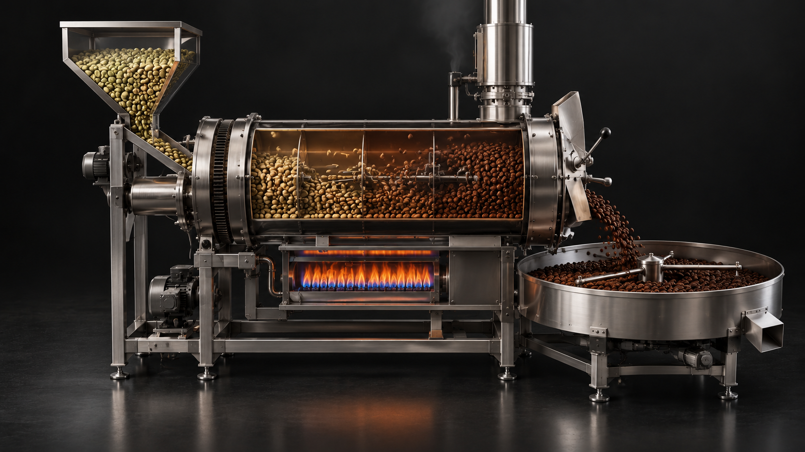 |

## Diseños de referencia (la animación isométrica)

Una imagen por estación de la planta. Sirven para saber qué máquina va en cada paso y en qué orden fluye el café; las tomas nuevas no tienen que copiar este estilo de línea.

**Planta completa (plano general)**

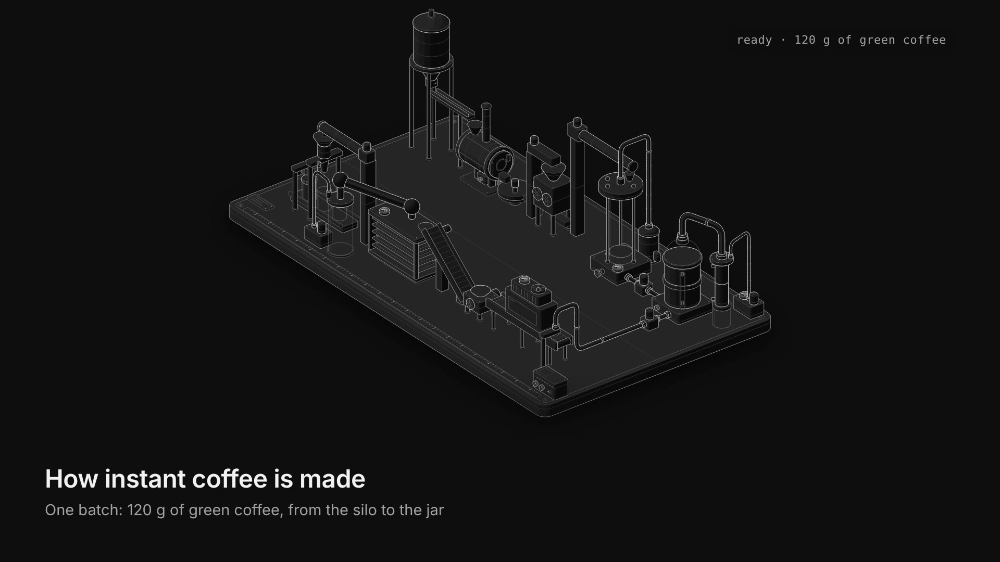

**1 · Roasting: silo, tostadora de tambor, bandeja de enfriado**

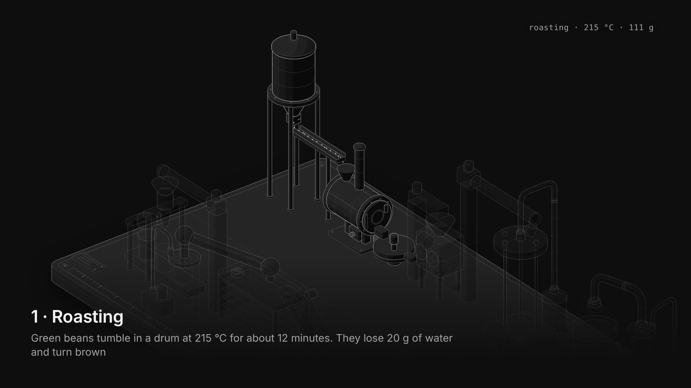

**2 · Grinding: elevador y molino de rodillos**

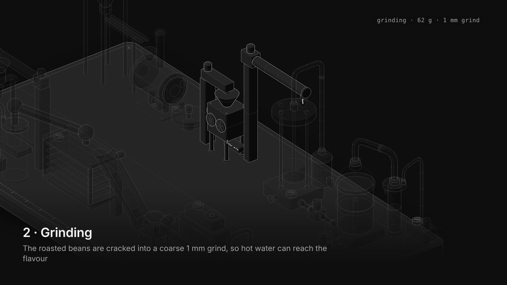

**3 · Extraction: columna de vidrio y caldera**

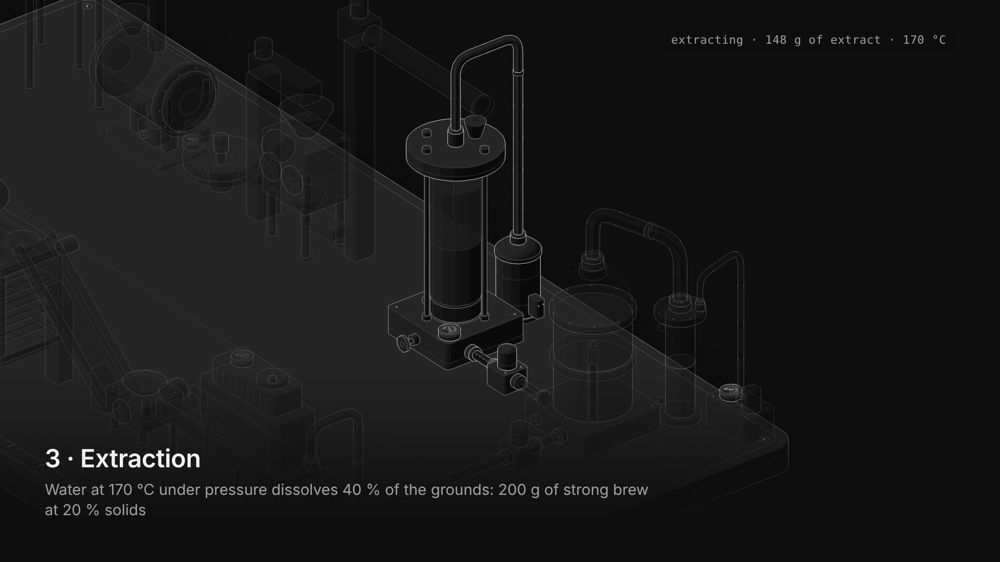

**4 · Concentration: evaporador al vacío y condensador**

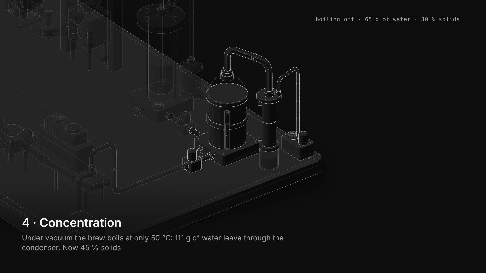

**5 · Freezing: congelador de banda con túnel**

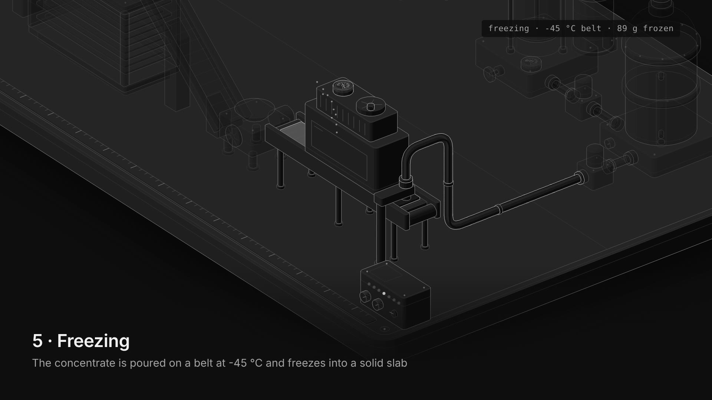

**6 · Granulating: granulador y cinta inclinada**

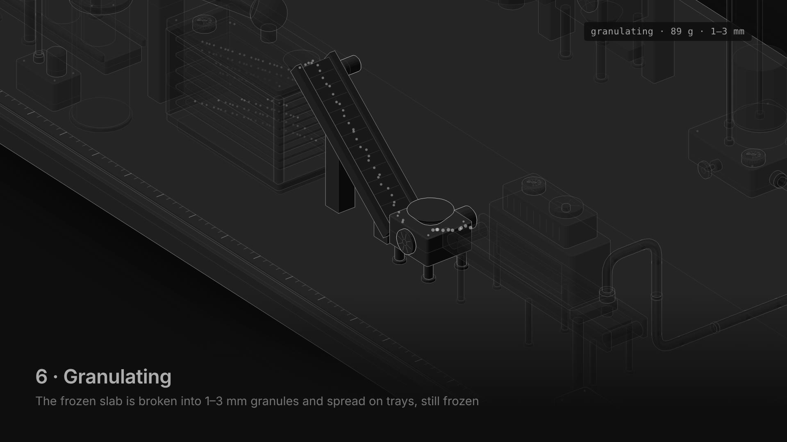

**7 · Freeze drying: cámara con bandejas y condensador de hielo**

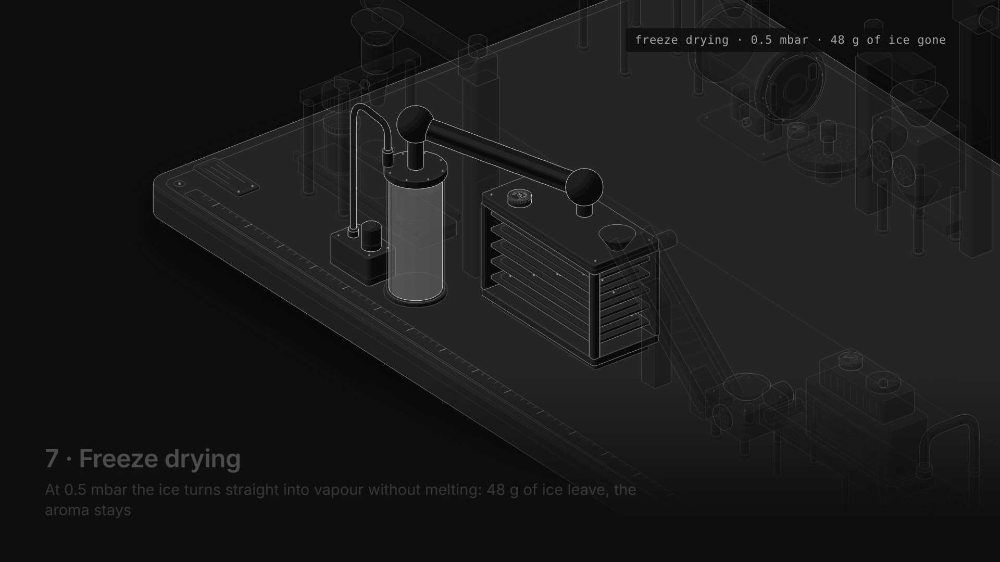

**8 · Packing: elevador, llenadora y frascos**

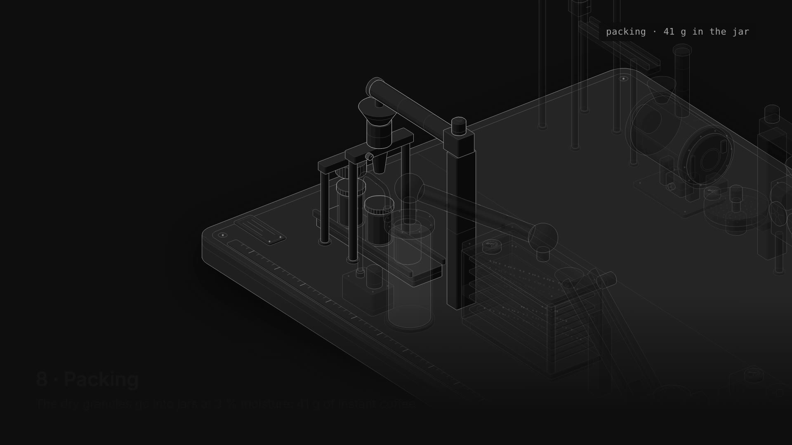

**Cierre: 41 g de café soluble, unas 21 tazas**

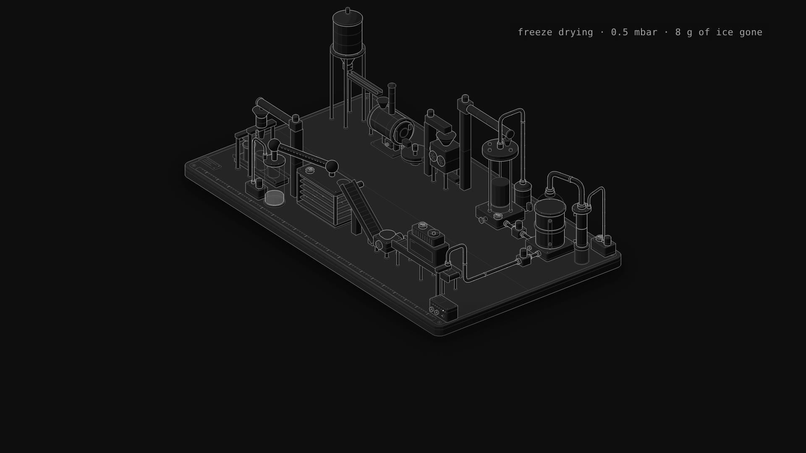

## Cómo usarlo en ChatGPT

1. Abre un chat nuevo y pega el contenido de `TRASPASO-CHATGPT.md` (desde "PROMPT MAESTRO").
2. Si ChatGPT no puede abrir los enlaces, descarga los archivos de esta carpeta y adjúntalos en el chat.
3. Escribe `siguiente` para generar la toma que falta, y `monta el prototipo` cuando estén todas.
